# NetSupport Manager RAT — Network Incident Investigation

## Project Overview

This project documents a hands-on SOC Tier 1 network investigation of suspected NetSupport Manager RAT activity using Wireshark.

The investigation is based on the **Easy As 123** traffic analysis exercise published by Malware-Traffic-Analysis.net on February 28, 2026.

The objective was to validate the reported security alert, identify the associated Windows workstation and user account, investigate suspicious network communication, extract indicators of compromise, and produce an evidence-based incident assessment and escalation decision.

## Investigation Summary

| Property | Details |
|---|---|
| Incident Date | February 28, 2026 |
| Investigation Type | Network Traffic Analysis |
| Analyst Role | SOC Analyst Tier 1 — Simulation |
| Primary Tool | Wireshark |
| Total Packets | 15,512 |
| Capture Duration | 4 hours, 21 minutes, 29 seconds |
| Reported Threat | NetSupport Manager RAT |
| Provisional Severity | High |
| Final Disposition | Escalate to Tier 2 / Incident Response |

## Project Documentation

- [Full Incident Investigation Report](report/incident-investigation-report.md)
- [Technical Findings](evidence/findings.md)
- [Investigation Timeline](evidence/timeline.csv)
- [Network IOCs](evidence/iocs.csv)
- [Wireshark Screenshots](evidence/screenshots/)
- [Dataset Information](dataset/README.md)

---

## 1. Investigation Workflow

    Initial Triage
          |
          v
    Endpoints & Conversations
          |
          v
    Host Identification
          |
          v
    User Attribution
          |
          v
    RAT Network Investigation
          |
          v
    Evidence Correlation & IOC Extraction
          |
          v
    Incident Assessment & Escalation
          |
          v
    Final Incident Report

---

## 2. Initial Triage & Traffic Analysis

### Capture File Properties

The investigation began with an examination of the packet capture metadata to establish the capture duration, packet count, file format, and evidence integrity reference.

| Property | Value |
|---|---|
| File Format | PCAP |
| Encapsulation | Ethernet |
| File Size | 6,581 KB |
| Total Packets | 15,512 |
| Average Packet Size | 408 bytes |
| Average Packet Rate | 1 packet/s |
| Capture Duration | 04:21:29 |

**Evidence — Wireshark Capture File Properties**

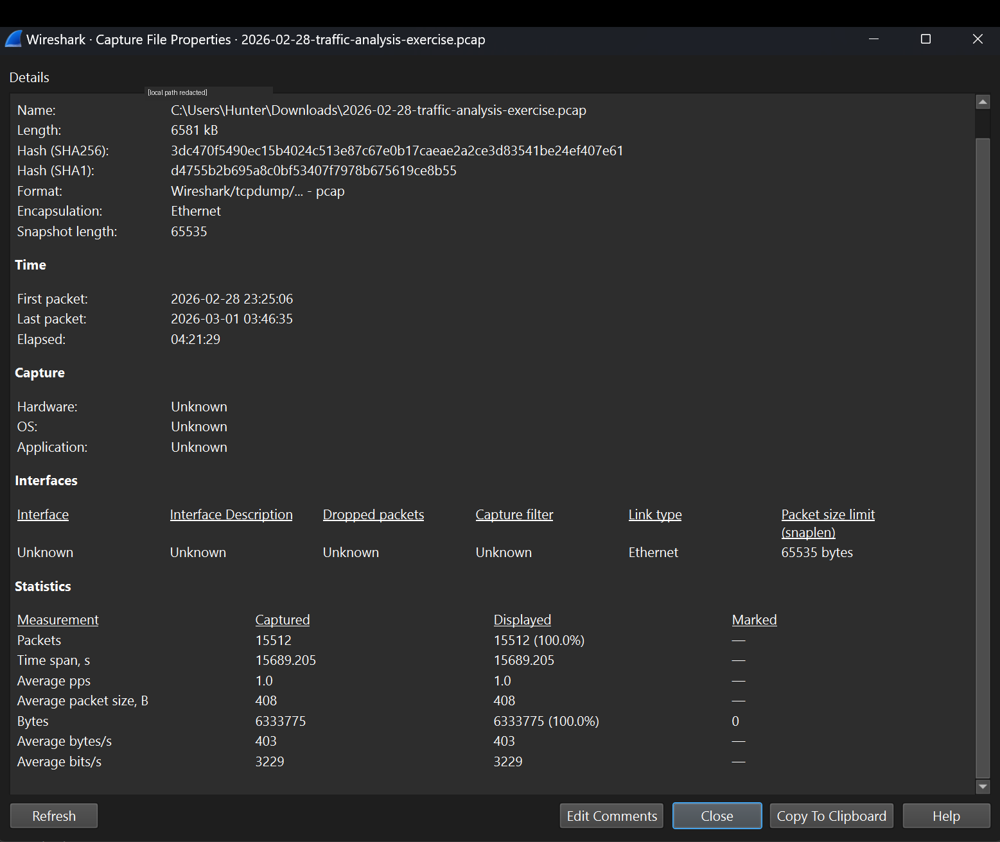

### Protocol Hierarchy

Wireshark Protocol Hierarchy statistics were examined to identify the protocols present in the capture and establish the overall traffic composition.

| Protocol | Observed Characteristics |
|---|---|
| TCP | 80.9% of captured packets |
| TLS | 46.0% of captured bytes |
| HTTP | 18.3% of captured bytes |
| UDP | 13.6% of captured packets |
| DNS | 5.2% of captured packets |

Additional protocols included SMB2, LDAP, Kerberos, NBNS, DHCP, ARP, QUIC, and DCE/RPC.

The presence of Windows authentication and directory service protocols provided useful evidence sources for subsequent host identification and user attribution.

**Evidence — Protocol Hierarchy Analysis**

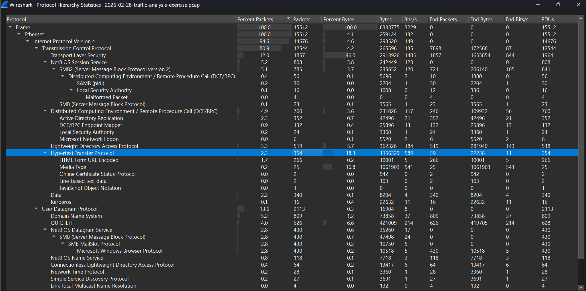

---

## 3. Endpoints & Conversations Analysis

IPv4 endpoint and conversation statistics were examined to identify prominent network participants and locate the remote endpoint reported in the security alert.

### IPv4 Endpoints

The primary internal endpoint was identified as `10.2.28.88`.

The alert-associated remote IP address `45.131.214.85` was also observed in the capture.

| IP Address | Packets | Observation |
|---|---:|---|
| 10.2.28.88 | 14,673 | Principal internal endpoint |
| 10.2.28.2 | 5,069 | Domain Controller / DNS |
| 23.64.147.24 | 1,268 | External TLS communication |
| 23.218.232.148 | 1,130 | External HTTP communication |
| 45.131.214.85 | 550 | Alert-associated remote endpoint |

**Evidence — IPv4 Endpoints**

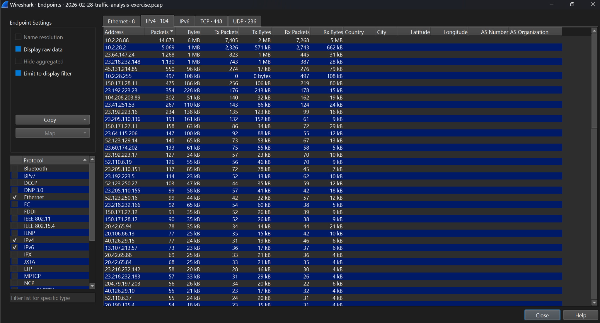

### TCP Conversation Analysis

The TCP Conversations view established the transport ports and stream identifiers of the prominent connections.

| Remote IP | Local Port | Remote Port | TCP Stream |
|---|---:|---:|---:|
| 23.64.147.24 | 51911 | 443 | 39 |
| 23.218.232.148 | 62035 | 80 | 319 |
| 45.131.214.85 | 51912 | 443 | 40 |

TCP stream 40 was selected for detailed investigation because it matched the remote endpoint identified in the initial security alert.

**Evidence — TCP Conversations**

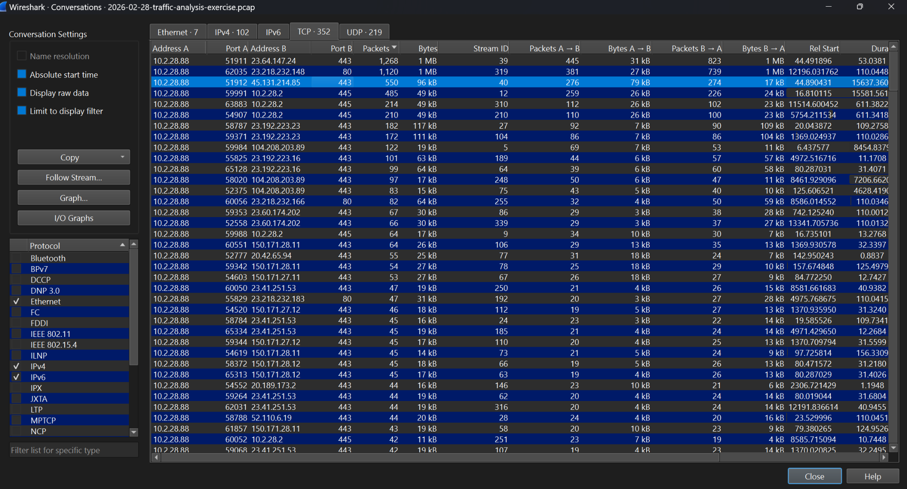

---

## 4. Host Identification

### F-001 — Alert-Associated Network Communication

The internal workstation initiated a successful TCP connection to the remote endpoint reported in the NetSupport Manager alert.

| Attribute | Observed Value |
|---|---|
| Internal Endpoint | 10.2.28.88:51912 |
| Remote Endpoint | 45.131.214.85:443 |
| TCP Stream | 40 |
| Total Packets | 550 |
| Outbound Traffic | Approximately 79 KB |
| Inbound Traffic | Approximately 17 KB |
| Conversation Duration | Approximately 4 hours and 20 minutes |

The TCP three-way handshake was established through the following frames:

| Frame | Direction | TCP Flags |
|---|---|---|
| 2569 | Internal → Remote | SYN |
| 2636 | Remote → Internal | SYN, ACK |
| 2637 | Internal → Remote | ACK |

**Assessment:** Confirmed network communication with the alert-associated remote endpoint.

**Confidence:** High.

**Evidence — Suspicious TCP Handshake**

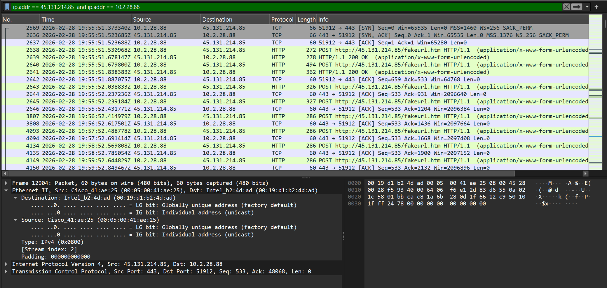

### F-002 — MAC Address Identification

Ethernet and IPv4 header inspection associated the internal endpoint with the following MAC address:

    IP Address: 10.2.28.88
    MAC Address: 00:19:d1:b2:4d:ad

Consistent addressing evidence was observed across DNS and external TCP communications.

**Primary evidence:** Frames 7, 1357, and 12953.

**Evidence — Ethernet and IPv4 Address Correlation**

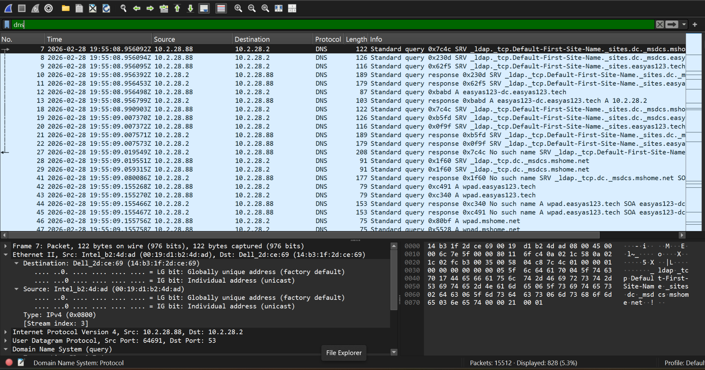

### F-005 — Windows Hostname Identification

NetBIOS Name Service traffic was examined using the Wireshark display filter:

    ip.addr == 10.2.28.88 && nbns

Frame 135 contained a NetBIOS name registration associating the workstation name with its internal IPv4 address.

    Hostname: DESKTOP-TEYQ2NR
    Registered Address: 10.2.28.88
    NetBIOS Suffix: 0x20

Frame 136 provided additional hostname registration evidence using suffix 0x00.

The NetBIOS suffixes identify service or name types and are not part of the workstation hostname.

**Evidence — NBNS Hostname Registration**

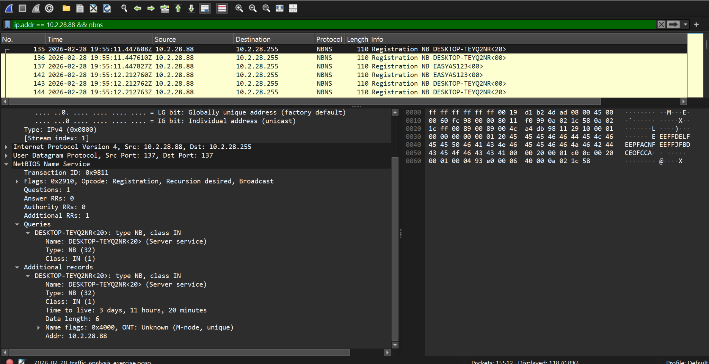

### Host Identity Summary

| Attribute | Verified Value |
|---|---|
| IPv4 Address | 10.2.28.88 |
| MAC Address | 00:19:d1:b2:4d:ad |
| Windows Hostname | DESKTOP-TEYQ2NR |
| Active Directory Domain | easyas123.tech |

---

## 5. User Attribution

### F-006 — User Account Identification

Kerberos authentication traffic was examined to identify the account associated with the workstation.

Wireshark display filter:

    kerberos && ip.addr == 10.2.28.88

Frame 251 contained a Kerberos AS-REQ with the following information:

    Client Principal: brolf
    Requested Service: krbtgt
    Realm: EASYAS123
    NetBIOS Hostname: DESKTOP-TEYQ2NR

The request linked the account name to the previously identified workstation.

**Evidence — Kerberos AS-REQ**

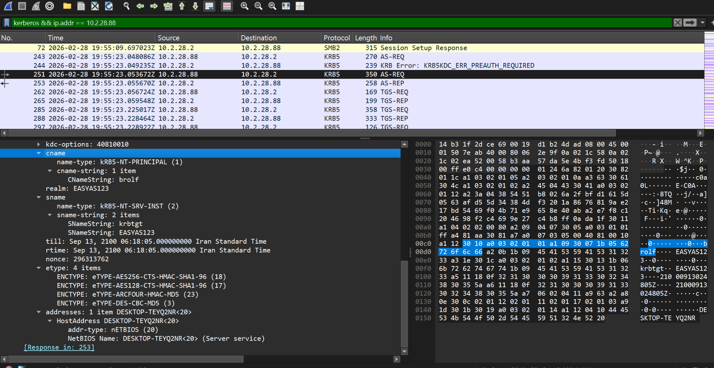

The corresponding AS-REP in frame 253 contained a Ticket Granting Ticket issued for the account brolf.

    Client Principal: brolf
    Client Realm: EASYAS123.TECH
    Ticket Service: krbtgt / EASYAS123.TECH
    Response to Frame: 251

**Evidence — Kerberos AS-REP and TGT Issuance**

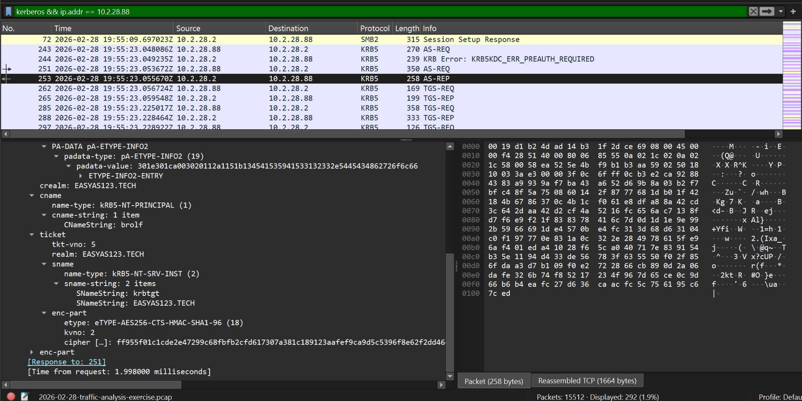

**Assessment:** The account brolf was associated with the investigated workstation through Kerberos authentication evidence.

Ticket issuance does not independently establish interactive desktop logon or responsibility for the suspected RAT activity.

### F-007 — Full Name Identification

SAMR traffic was examined using the following display filter:

    samr && ip.addr == 10.2.28.88

Frame 338 contained a QueryUserInfo request. The corresponding response in frame 339 provided:

    Account Name: brolf
    Full Name: Becka Rolf

Both values were observed within the same SAMR response, directly establishing the relationship between the username and its recorded full name.

**Evidence — SAMR QueryUserInfo Response**

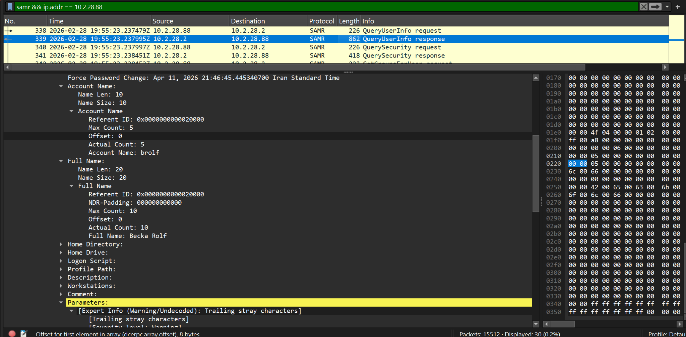

### Final Host and User Correlation

| Identity Attribute | Verified Value | Evidence |
|---|---|---|
| IP Address | 10.2.28.88 | TCP Stream 40 |
| MAC Address | 00:19:d1:b2:4d:ad | Ethernet headers |
| Hostname | DESKTOP-TEYQ2NR | NBNS frames 135, 136 |
| Username | brolf | Kerberos frames 251, 253 |
| Recorded Full Name | Becka Rolf | SAMR frame 339 |
| Domain | easyas123.tech | Kerberos, DNS, LDAP |

All five primary identification objectives of the original exercise were completed.

---

## 6. NetSupport RAT Network Investigation

### F-003 — NetSupport Application Communication

TCP stream 40 was examined using:

    tcp.stream eq 40

Application-layer analysis revealed HTTP communication on TCP port 443 rather than conventional TLS-protected HTTPS.

### HTTP Client Request — Frame 2638

    POST http://45.131.214.85/fakeurl.htm HTTP/1.1
    User-Agent: NetSupport Manager/1.3
    Content-Type: application/x-www-form-urlencoded
    Connection: Keep-Alive

The HTTP request body contained:

    CMD=POLL
    INFO=1
    ACK=1

Wireshark also generated a security warning indicating unencrypted HTTP traffic over a port commonly associated with encrypted communication.

**Evidence — NetSupport HTTP POST Request**

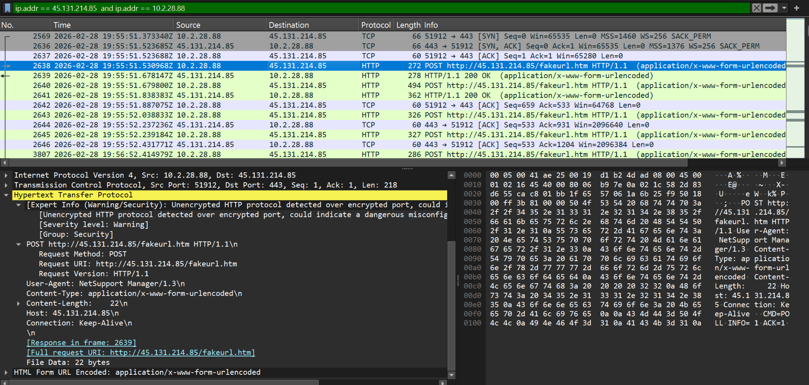

### HTTP Server Response — Frame 2639

    HTTP/1.1 200 OK
    Server: NetSupport Gateway/1.92 (Windows NT)
    Content-Type: application/x-www-form-urlencoded
    Connection: Keep-Alive

The response body included the application fields CMD=ENCD, ES=1, and DATA.

The NetSupport client and gateway identifiers provided mutually supporting evidence for the application protocol identification.

**Evidence — NetSupport Gateway Response**

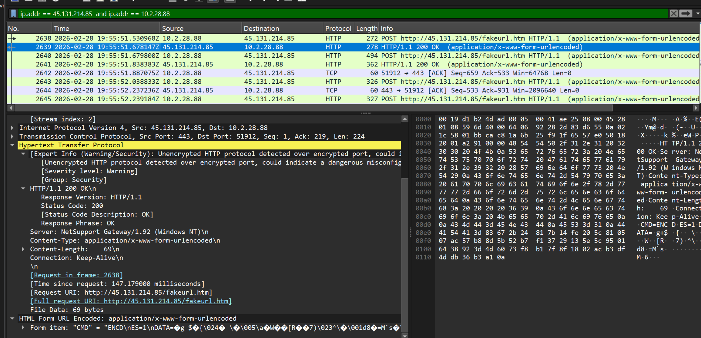

### HTTP Stream Analysis

Follow HTTP Stream was used to examine the application conversation between the internal workstation and the remote endpoint.

The stream contained:

- NetSupport Manager client identification.
- NetSupport Gateway server identification.
- HTTP POST requests to `/fakeurl.htm`.
- CMD=POLL application messages.
- CMD=ENCD messages and opaque DATA fields.

Some application data remained unreadable. Its exact encoding or encryption mechanism was not established.

**Evidence — Follow HTTP Stream**

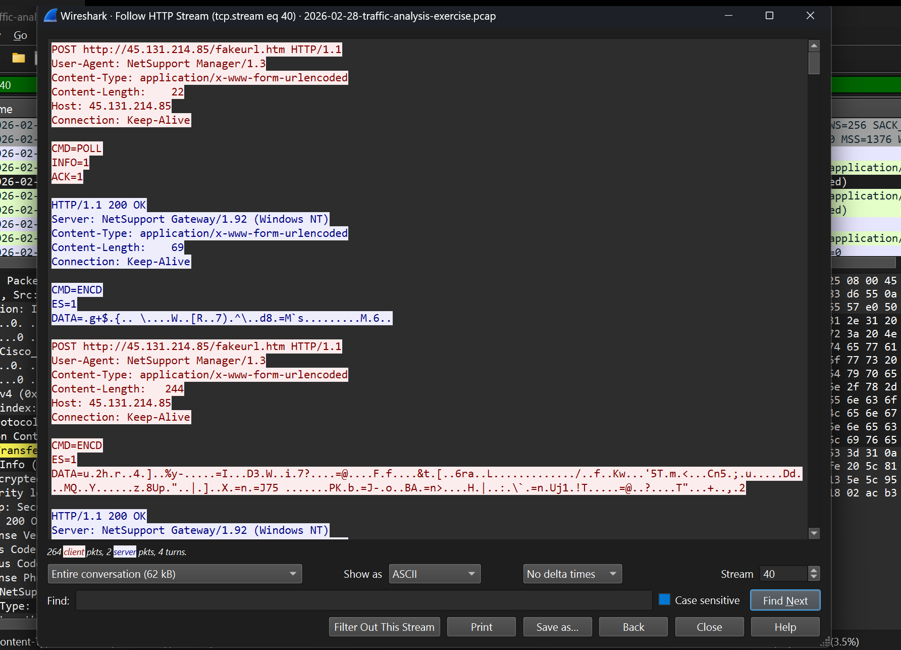

**Assessment:** The observed communication strongly corroborated the reported NetSupport Manager RAT alert.

**Confidence:** High for NetSupport-compatible network communication. Unauthorized or malicious use requires further validation.

### F-004 — Recurring HTTP Polling

Repeated HTTP POST requests were observed from the internal workstation to the alert-associated remote endpoint.

| Frame | Timestamp (UTC) |
|---|---|
| 3807 | 19:56:52.414979 |
| 4093 | 19:57:52.488778 |
| 4134 | 19:58:52.569808 |
| 4149 | 19:59:52.644829 |
| 4201 | 20:00:52.829091 |
| 4211 | 20:01:52.909105 |

The reviewed sequence demonstrated intervals of approximately 60 seconds between requests.

The long-lived TCP conversation, repeated POST requests, and application polling messages were consistent with persistent remote-access communication and a possible command-and-control pattern.

**Evidence — Recurring NetSupport Requests**

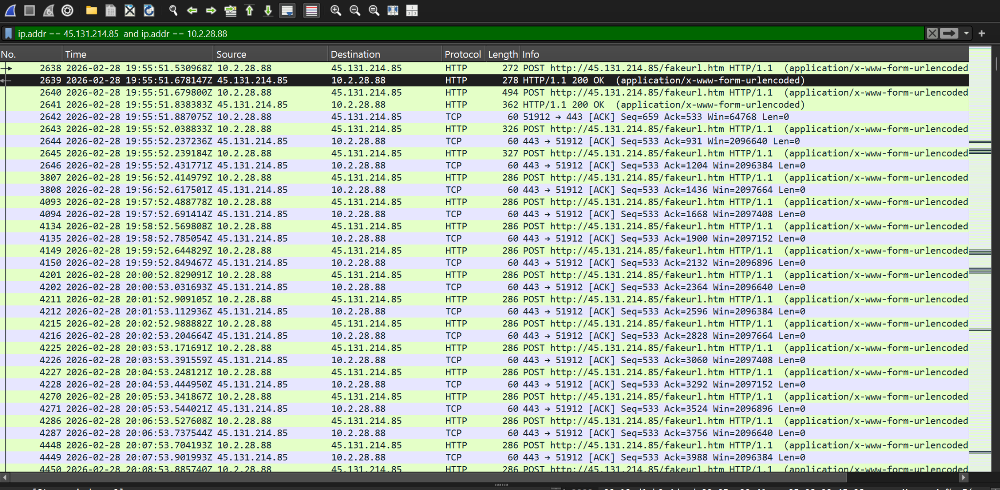

**Assessment:** Confirmed recurring NetSupport-compatible communication. Specific attacker commands and malicious command execution were not established.

---

## 7. Related Network Activity

Selected background communications were examined to distinguish them from the reported NetSupport activity.

| Remote Endpoint | Observation |
|---|---|
| 23.64.147.24:443 | TLS communication with SNI www.fmcsa.dot.gov |
| 23.218.232.148:80 | Microsoft BITS-related HTTP content retrieval |
| 23.47.50.182:80 | Windows NCSI connectivity test |

The reviewed Microsoft BITS transfer occurred several hours after the initial observed NetSupport connection. No direct relationship with the investigated alert was identified.

A DNS query for `vadusa[.]xyz` was observed shortly before the initial NetSupport connection. Its relationship to the suspicious remote endpoint remained unverified.

The initial infection vector was not established from the reviewed packet evidence.

Additional screenshots and technical observations are available in the [evidence directory](evidence/) and [full investigation report](report/incident-investigation-report.md).

---

## 8. Indicators of Compromise & Detection Context

| Indicator Type | Value |
|---|---|
| Remote IP | 45.131.214[.]85 |
| Destination Port | TCP 443 |
| HTTP URI | /fakeurl.htm |
| User-Agent | NetSupport Manager/1.3 |
| Server Header | NetSupport Gateway/1.92 (Windows NT) |
| Application Message | CMD=POLL |
| Application Message | CMD=ENCD |
| Behavioral Pattern | HTTP POST at approximately 60-second intervals |

The remote IP address represents the principal alert-associated network indicator.

The additional application identifiers and communication patterns provide context for detection engineering, SIEM searches, and threat hunting.

NetSupport Manager is a legitimate remote administration product that may also be abused. Individual application identifiers or periodic communication patterns do not independently establish compromise.

**Download:** [IOC Table — CSV](evidence/iocs.csv)

---

## 9. Investigation Timeline

All timestamps are expressed in UTC on February 28, 2026.

| Time | Event | Evidence |
|---|---|---|
| 19:55:06 | Capture begins | Frame 1 |
| 19:55:08 | Domain service discovery | Frames 7–13 |
| 19:55:09 | Windows connectivity check | Frames 87, 89 |
| 19:55:11 | NBNS hostname registration | Frames 135, 136 |
| 19:55:23 | Kerberos authentication for brolf | Frames 251, 253 |
| 19:55:23 | SAMR account information | Frame 339 |
| 19:55:51 | Unverified DNS lead | Frames 1559, 1747 |
| 19:55:51 | Initial NetSupport TCP connection | Frames 2569–2637 |
| 19:55:51 | NetSupport HTTP request and response | Frames 2638, 2639 |
| 19:56:52 onward | Recurring HTTP POST requests | Frames 3807, 4093, 4134, 4149, 4201, 4211 |
| 23:18:22 | Microsoft BITS content retrieval | Frames 12953–12972 |

The initial observed NetSupport connection began approximately 45 seconds after the capture started.

**Download:** [Investigation Timeline — CSV](evidence/timeline.csv)

---

## 10. Final Security Assessment

| Attribute | Assessment |
|---|---|
| Alert Validation | Strongly Corroborated |
| Identified Workstation | DESKTOP-TEYQ2NR |
| Associated Account | brolf |
| Network Communication | Confirmed |
| Malicious or Unauthorized Use | Suspected |
| Initial Infection Vector | Undetermined |
| Actual Endpoint Impact | Undetermined |
| Provisional Severity | High |
| Final Disposition | Escalate to Tier 2 / Incident Response |

The investigation identified the workstation and associated user account involved in the reported NetSupport communication.

The successful TCP connection, NetSupport-compatible HTTP identifiers, application messages, and recurring communication strongly corroborated the reported alert.

The available network evidence was sufficient to complete the SOC Tier 1 investigation and establish an evidence-supported escalation decision.

### Recommended Follow-up

- Validate NetSupport installation and authorization through endpoint telemetry.
- Identify the process responsible for the external communication.
- Investigate the original infection or installation mechanism.
- Review endpoint activity for persistence, command execution, and unauthorized data access.
- Search additional systems and network logs for related indicators.

### Investigation Limitations

The network investigation did not independently establish unauthorized software use, attacker-issued command execution, data exfiltration, lateral movement, or the original infection vector.

No endpoint containment or remediation actions were performed during this educational investigation.

**Full Report:** [NetSupport RAT Incident Investigation Report](report/incident-investigation-report.md)

---

## 11. Tools and Skills Demonstrated

- Wireshark packet inspection and display filtering
- PCAP metadata and Protocol Hierarchy analysis
- IPv4 Endpoints and TCP Conversations analysis
- TCP three-way handshake validation
- HTTP request, response, and stream analysis
- DNS and NBNS investigation
- Active Directory network traffic analysis
- Kerberos authentication and TGT inspection
- SAMR account information extraction
- Host and user evidence correlation
- Network IOC identification
- Incident timeline reconstruction
- SOC alert triage and escalation
- Professional cybersecurity documentation

---

## Repository Structure

    netsupport-rat-network-investigation/
    |
    |-- README.md
    |-- .gitignore
    |
    |-- report/
    |   |-- incident-investigation-report.md
    |
    |-- evidence/
    |   |-- screenshots/
    |   |-- findings.md
    |   |-- timeline.csv
    |   |-- iocs.csv
    |
    |-- dataset/
        |-- README.md

## Dataset

The original training dataset is available at:

[Malware-Traffic-Analysis.net — Easy As 123 (February 28, 2026)](https://www.malware-traffic-analysis.net/2026/02/28/index.html)

The raw PCAP and potentially malicious files are not redistributed in this repository.

## Disclaimer

This project was completed for educational purposes using a publicly available cybersecurity training dataset.

All analysis was performed as part of a simulated SOC investigation. No production systems were targeted, and no containment or remediation actions were performed.

## Author

**Alireza Rahmani**

Cybersecurity Portfolio | SOC Analysis | Network Traffic Investigation

[GitHub Profile](https://github.com/alirezarahmani-cyber)
